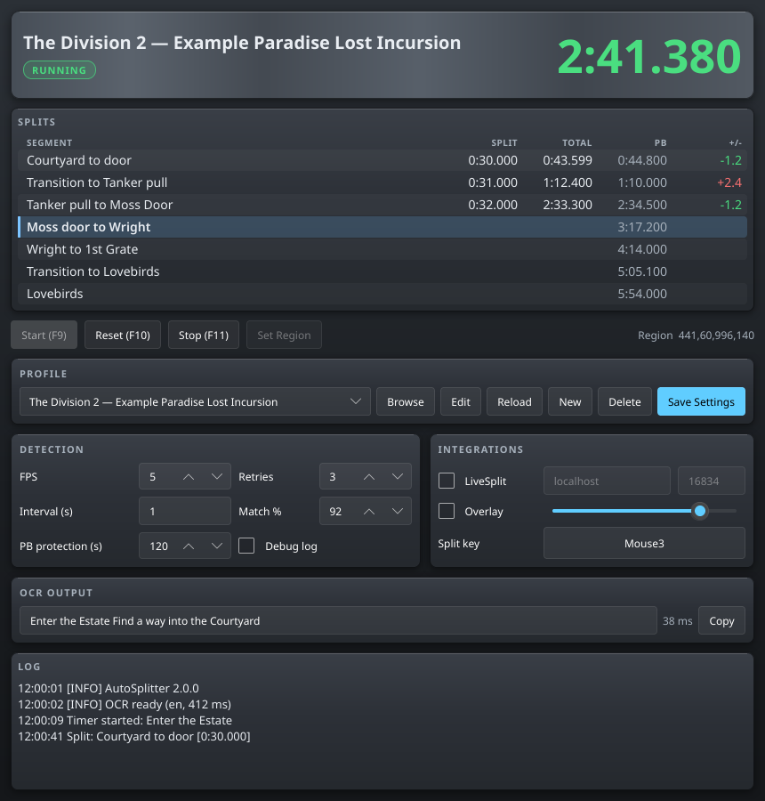
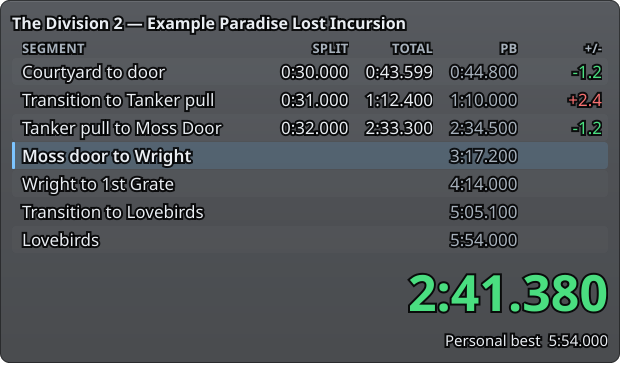
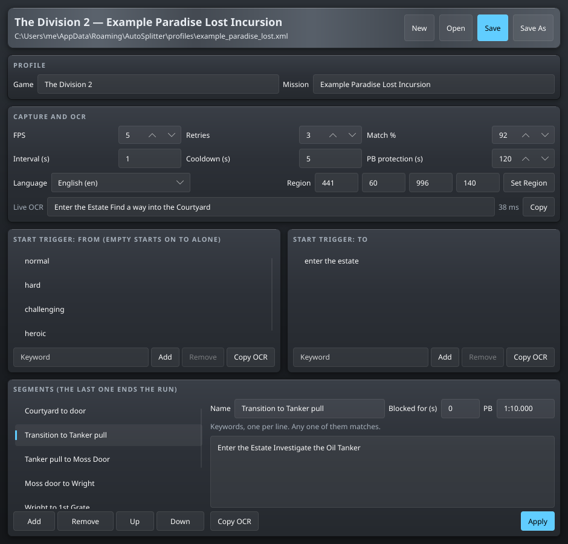

# AutoSplitter guide

AutoSplitter reads the text a game shows on screen and starts or splits your speedrun timer when that text matches a keyword in your profile. It sends the same events to LiveSplit Server, or it works on its own with its built-in timer. It was written for Tom Clancy's The Division 2, and it works with any game that shows text you can match.



## Contents

- [Install](#install)
- [First run](#first-run)
- [Keys](#keys)
- [The main window](#the-main-window)
- [Set Region](#set-region)
- [The overlay](#the-overlay)
- [The Profile Editor](#the-profile-editor)
- [LiveSplit](#livesplit)
- [Profile reference](#profile-reference)
- [Personal bests](#personal-bests)
- [Updates](#updates)
- [How detection works](#how-detection-works)
- [Tips and troubleshooting](#tips-and-troubleshooting)

## Install

AutoSplitter needs Windows 10 or 11, 64-bit. It needs no GPU and no other software: the OCR models and the C++ runtime come with it.

Download one of these files from the [releases page](https://github.com/KimP0ssible-no/AutoSplitter/releases/latest):

| File | Use |
| --- | --- |
| `autosplitter-X.Y.Z-x64-setup.exe` | The installer. It adds a Start menu entry and an uninstaller. Profiles go to `%APPDATA%\AutoSplitter\profiles`. |
| `autosplitter-X.Y.Z-x64-portable.zip` | The portable version. Unpack it into any folder, for example `C:\Tools\AutoSplitter\`, and run `AutoSplitter.exe`. Profiles stay in the `profiles` folder beside it. |

At its first start, AutoSplitter puts two example profiles for The Division 2 into the profile folder: Paradise Lost and Lincoln Memorial. Updates and the uninstaller never replace or delete profiles.

AutoSplitter 1.x updates itself to 2.x when it starts. The update keeps the `profiles` folder and the personal bests in it.

## First run

1. Start AutoSplitter. Select a profile, or click New to make one for your game.
2. Start the game at the resolution you play at, in windowed or borderless windowed mode.
3. Click Set Region. Drag a rectangle around the place where the game shows its objective or mission text, then press S or Enter. See [Set Region](#set-region).
4. Edit the profile: each segment needs one or more keywords, and the start trigger needs at least one `<To>` keyword. Click Edit to open the [Profile Editor](#the-profile-editor).
5. Click Start or press F9, then play. Turn on Debug log to see what OCR reads.

## Keys

These keys work while the game has focus and AutoSplitter is in the background:

| Key | Action |
| --- | --- |
| F9 | Start: screen capture, OCR and the timer. The timer itself starts when the start trigger shows. |
| F10 | Reset: the timer and all split times go back to zero. Capture keeps running. |
| F11 | Stop: capture and OCR stop. |
| Middle mouse button | The split key. During a run it moves to the next segment. Before the start trigger shows, it starts the run. |

To choose another split key, click the Split key button under Integrations, then press a keyboard key or mouse button 3, 4 or 5. Esc cancels. Click Save Settings to keep the key in the profile.

F9, F10 and F11 are registered with Windows, so the game does not receive them while AutoSplitter runs. If another program has registered one of them first, the log shows an error at start.

After the split key, OCR splits wait for the profile's cooldown, 5 seconds by default.

## The main window

### Header

The header shows the profile as "Game — Mission", the timer, and a badge with the run state:

| Badge | Meaning |
| --- | --- |
| STOPPED | Capture is off. |
| WAITING FOR THE START TRIGGER | Capture and OCR run. The timer starts when the start trigger text shows. |
| RUNNING | The timer runs. |
| RUN COMPLETE | The final segment matched. The timer turns gold and shows the total. |

### Splits

| Column | Meaning |
| --- | --- |
| Segment | The segment name from the profile. A blue bar marks the current segment. |
| Split | The time of this segment alone. |
| Total | The time from the start of the run to the end of this segment. |
| PB | The personal best total for this segment. |
| +/- | The difference from the PB. A minus sign (green) is ahead of the PB, a plus sign (red) is behind it. |

The table is as tall as the profile's segments, up to 12. A longer profile scrolls. When you make the window taller, only the log grows.

### Buttons

| Button | Action |
| --- | --- |
| Start (F9) | Starts capture and OCR, and connects to LiveSplit if it is on. |
| Reset (F10) | Clears the run and sends a reset to LiveSplit. Capture keeps running. |
| Stop (F11) | Stops capture and OCR, and sends a reset to LiveSplit. |
| Set Region | Opens the region picker. It works only while capture is stopped. |

### Profile

| Control | Action |
| --- | --- |
| Profile list | All `.xml` files in the profile folder. Selecting one loads its segments and settings. |
| Browse | Copies a profile from another folder into the profile folder and selects it. |
| Edit | Opens the selected profile in the Profile Editor. |
| Reload | Reads the profile from disk again. Settings you did not save are lost. |
| New | Makes a profile from a template and opens it in the Profile Editor. |
| Delete | Deletes the selected profile and its personal bests, after a question. |
| Save Settings | Writes every setting in the window to the profile. |

### Detection

| Setting | Default | Range | Meaning |
| --- | --- | --- | --- |
| FPS | 5 | 1 to 30 | Screen captures per second. 5 is enough for most games. More costs CPU. |
| Retries | 3 | 1 to FPS minus 1 | How many recent captures OCR tries, newest first, before it gives up on a pass. |
| Interval (s) | 1 | 0.1 and up | Seconds between OCR passes. A shorter interval finds text sooner but costs CPU. |
| Match % | 92 | 50 to 100 | How close the OCR text must be to a keyword. 92 accepts one or two misread letters. |
| PB protection (s) | 120 | 0 and up | A run that beats the PB by this much or more is not offered as a PB. See [Personal bests](#personal-bests). |
| Debug log | Off | | Logs every OCR pass, every key, and how far back the text first showed. Each pass also saves the image OCR read to `%TEMP%\autosplitter-ocr.png`. |

### Integrations

| Setting | Default | Meaning |
| --- | --- | --- |
| LiveSplit | Off | Connect to LiveSplit Server at Start. The two fields are the host and the port, `localhost` and `16834`. |
| Overlay | Off | Show the overlay. The slider sets the opacity of its background. |
| Split key | Mouse3 | The key for a split by hand. See [Keys](#keys). |

### OCR output and log

The OCR output panel shows the text of the last OCR pass on one line, and how long OCR took. Copy puts the text on the clipboard.

The log shows starts, splits, warnings and errors, up to 1000 lines.

## Set Region

Set Region takes a picture of one monitor and shows it full screen. The picker opens on the monitor that holds the profile's current region, or on the primary monitor if the region is on no monitor.

| Key or mouse | Action |
| --- | --- |
| Drag | Draws the region. |
| S or Enter | Saves the region to the profile and closes the picker. |
| Tab | Moves the picker to the next monitor. |
| Esc or Q | Closes the picker and keeps the old region. |

Draw the region tightly around the text. A small region is read faster and more accurately. The region can be on any monitor.

## The overlay



The overlay shows the profile name, the splits, the timer and the personal best above the game. It stays above windowed and borderless windowed games. It does not show over a game in exclusive full screen.

- To show or hide it, use the Overlay check box.
- To move it, drag it.
- To resize it, drag the blue corner mark that shows in its bottom-right corner while the mouse is over the overlay. The text and the timer scale with it.
- The opacity slider fades only the background. The text has a dark outline and stays readable over any scene.
- Click Save Settings to keep the position, the size and the opacity in the profile.

## The Profile Editor



The Profile Editor (`ProfileEditor.exe`) edits a profile without XML. The Edit and New buttons in the main window open it.

- Profile: the game and mission names.
- Capture and OCR: the same detection settings as the main window, the cooldown, the OCR language (English or Simplified Chinese) and the region. Set Region works as in the main window.
- Live OCR: the editor reads the region once a second and shows the text. Copy OCR copies that text into a keyword field.
- Start trigger: the From and To keyword lists. See [The start trigger](#the-start-trigger).
- Segments: add, remove and reorder segments. Each segment has a name, a block time in seconds (`pte`), a PB and keywords, one per line. Type the PB as `1:13.456` or as seconds, or clear the field to remove it. Click Apply to keep the changes of a segment. The last segment always ends the run.

If you close the editor or open another profile with unsaved changes, it asks whether to save them.

## LiveSplit

To send starts and splits to LiveSplit:

1. In LiveSplit, right-click and select Edit Layout, then add the LiveSplit Server component.
2. Right-click and select Control > Start Server. Do this each time you start LiveSplit.
3. In AutoSplitter, select LiveSplit under Integrations, and make sure that the host is `localhost` and the port is `16834`.
4. Click Save Settings, then Start. The log shows "LiveSplit connected", or a warning if the server does not answer. Without LiveSplit, AutoSplitter keeps its own timer.

AutoSplitter sends these commands:

| Command | When |
| --- | --- |
| `starttimer`, `initgametime` | The run starts. |
| `skipsplit` | Once for each segment the run skipped. |
| `setgametime` | Before each split, with the time AutoSplitter measured. |
| `split` | A segment matched, or the split key was pressed. |
| `reset` | Reset or Stop. |

In LiveSplit, select Compare Against > Game Time to use the times AutoSplitter measured from the screen captures.

## Profile reference

A profile is an XML file in the profile folder. You can share a profile by sharing its file: the personal bests in it belong to that file.

```xml
<SplitProfile profileVersion="2">
  <Game>The Division 2</Game>
  <Mission>Paradise Lost</Mission>
  <Capture targetFps="5" />
  <Detection cooldownSeconds="5" pbProtectionSeconds="120">
    <Pixel enabled="true" fadeThreshold="12" fadeFramesRequired="5" />
    <OCR enabled="true" region="441,60,996,140" intervalSeconds="1" changeThreshold="0.6"
         fuzzyMatchThreshold="0.92" ocrRetryFrames="3" language="en" />
  </Detection>
  <StartTrigger>
    <From>heroic</From>
    <To>enter the estate</To>
  </StartTrigger>
  <Segments>
    <Segment name="Courtyard to door" pb="44.800">
      <Keyword>find a way into the courtyard</Keyword>
    </Segment>
    <Segment name="Lovebirds" final="true" pte="240">
      <Keyword>paradise lost</Keyword>
    </Segment>
  </Segments>
  <LiveSplit enabled="false" host="localhost" port="16834" />
  <Overlay enabled="true" x="1" y="295" opacity="80" scale="1" />
  <Hotkeys manualSplitKey="Mouse3" />
</SplitProfile>
```

| Element | Attribute | Default | Meaning |
| --- | --- | --- | --- |
| SplitProfile | profileVersion | 2 | The format version. AutoSplitter writes an older profile again in the current format and keeps all its values. |
| Capture | targetFps | 5 | Screen captures per second, 1 to 30. |
| Detection | cooldownSeconds | 5 | Seconds after the split key in which OCR splits wait. |
| Detection | pbProtectionSeconds | 120 | A run this much faster than the PB is not offered as a PB. |
| Pixel | all | | Read and kept from 1.x, not used. |
| OCR | enabled | true | OCR on or off. |
| OCR | region | | Left, top, right, bottom in desktop pixels. Set it with Set Region. |
| OCR | intervalSeconds | 1 | Seconds between OCR passes. |
| OCR | changeThreshold | 0.6 | While the run waits for its start trigger, text this similar to the last read is not checked again. 0 to 1. |
| OCR | fuzzyMatchThreshold | 0.92 | Match % divided by 100. |
| OCR | ocrRetryFrames | 3 | Retries: recent captures tried per pass, at most FPS minus 1. |
| OCR | language | en | `en` or `zh-CN` (Simplified Chinese). Chinese output keeps only Chinese characters. |
| StartTrigger | From, To | | Keywords that start the run. See [The start trigger](#the-start-trigger). |
| Segment | name | | The name in the splits table. |
| Segment | final | | `true` on the segment that ends the run. The Profile Editor sets it on the last segment. |
| Segment | pb | | The personal best total in seconds. AutoSplitter writes it when you save a PB. |
| Segment | pte | 0 | Seconds after the start before this segment can match. Use it when its keyword can also show early in the run. |
| Keyword | | | Text to match. Several keywords in one segment are alternatives: any one of them matches. |
| LiveSplit | enabled, host, port | false, localhost, 16834 | The LiveSplit Server connection. |
| Overlay | enabled, x, y, opacity, scale | false, 100, 100, 80, 1 | The overlay, its position in desktop pixels, its background opacity in percent, and its size. |
| Hotkeys | manualSplitKey | Mouse3 | `Mouse3` to `Mouse5`, `F1` to `F12`, or `VK` with a Windows key code, for example `VK107`. |

AutoSplitter reads attributes it does not know, such as `engine` from 1.x, and drops them when it writes the profile again.

## Personal bests

When the final segment matches, the timer turns gold and the run is complete. If the run is a personal best, a gold bar under the header shows the new time and the old one, with Save PB and Discard:

- If the profile has no PB yet, every complete run is offered.
- If the run beats the PB by less than the PB protection (120 seconds by default), it is offered.
- If the run beats the PB by the PB protection or more, it is not offered, and the log says so. Such a run usually comes from a reset or a final keyword that matched too early.
- A slower run is not offered.

Save PB writes the total of each segment to its `pb` attribute. A segment that the run skipped keeps its old PB. Starting a new run drops an offer you did not answer.

## Updates

At start, AutoSplitter reads `https://kimp0ssible-no.github.io/AutoSplitter/version.json`, one request that sends nothing about you or your runs. If a newer version exists, it shows what changed and asks whether to update.

- The setup version downloads the new setup, installs it and starts AutoSplitter again.
- The portable version downloads the new zip and unpacks it over its folder, except the `profiles` folder.
- A version that came neither way opens the release page.

AutoSplitter installs a download only if the release's `SHA256SUMS` is signed with the AutoSplitter release key and lists the file with the same checksum. Without an internet connection, the check fails quietly.

## How detection works

### Capture and OCR

AutoSplitter captures the region FPS times a second and keeps the captures of the last OCR interval, each with the time it was taken. Captures with fewer than 20 bright pixels are dropped, because OCR finds only noise in them. Once per interval, OCR reads the captures, newest first. On a still screen it reads the last captures again.

### The start trigger

The run starts in one of two ways:

- Two steps, when the profile has `<From>` keywords: OCR must see a From keyword first. A To keyword in a later OCR pass then starts the run. For example, `<From>Loading</From>` and `<To>Mission start</To>` start the run when "Mission start" shows after "Loading".
- One step, when the profile has no `<From>` keyword: the first To keyword starts the run. Use this only when the To text shows nowhere before the run, for example not in a menu or a replay.

The split key also starts a run that waits for its start trigger.

### Matching

A keyword matches when OCR text holds it, with up to the Match % of its letters right. Case does not matter. A second check ignores spaces, because OCR sometimes joins two words. At 92%, "Secure the Area" matches "Secure the Areo", but not "Search the Bar".

### Timing

When a capture matches, OCR goes back through the older captures while they still show the same keywords. The earliest of them gives the time of the start or split. At 5 FPS this is within 200 ms of the moment the text showed. AutoSplitter 1.x used the newest matching capture, up to one interval later.

### Segments

After a split, OCR looks for every later segment, not only the next one. If a later segment matches, the run skips the segments between, and LiveSplit gets one skip for each. A segment with a `pte` block time cannot match during its first seconds of the run.

## Tips and troubleshooting

- OCR reads nothing or the wrong text: turn on Debug log, and look at `%TEMP%\autosplitter-ocr.png`. It is the exact image OCR read. Set the region again so that it covers the text tightly.
- The wrong segment splits: raise Match % to 95 to 98, or make the keywords longer and more specific.
- OCR misreads letters: add the misread text as another `<Keyword>` of the segment. Debug log shows what OCR reads.
- LiveSplit does not connect: start the server in LiveSplit (Control > Start Server) before you click Start.
- The overlay does not show: select Overlay, and run the game windowed or borderless windowed.
- Set Region is greyed out: stop capture first with Stop or F11.
- F9, F10 or F11 do nothing: look for an error about global keys at the top of the log. Another program can hold the same keys.
- OCR takes about 20 to 50 ms per pass on a desktop CPU. The OCR output panel shows the time of each pass.
